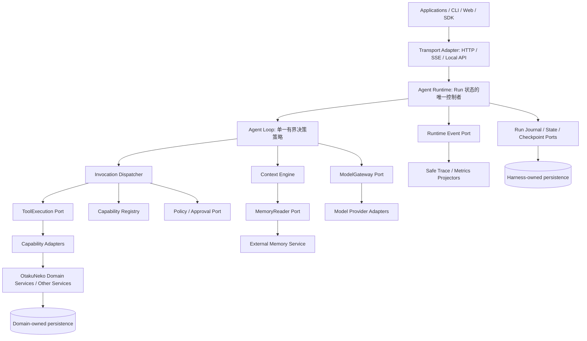

# Harness Core — 架构基线 v1

> **状态：** Accepted，作为新仓库的初始架构基线（2026-10-28）。  
> **目标：** 构建**独立、通用的 Harness Core**。OtakuNeko 旧代码只作为实现参考，不能决定新架构。  
> **配套规范：** [`CONTRACTS.md`](CONTRACTS.md)、[`ADR-0001.md`](docs/adr/ADR-0001.md)、[`MIGRATION.md`](docs/migration/MIGRATION.md)。

## 一、目标与非目标

构建一个可独立安装的 Agent 执行内核：管理有界、可观测、经过授权的「模型 → 工具 → 反馈」循环。内核应能独立于 Web 前端、FastAPI、OtakuNeko 业务服务、特定数据库、Memory 实现及模型 Provider 演进。

**整个系统建立在三套协议上：**

1. **Execution Protocol（执行协议）：** 谁能运行、Session/Run/Step 生命周期、模型和工具决策、审批、预算、执行事实及恢复。
2. **Context Protocol（上下文协议）：** 从指令、会话历史、工具结果和可选记忆，构造每次调用模型的 `ContextSnapshot`，保留信任标签、来源与 Token 约束。
3. **Memory Protocol（记忆协议）：** Core 通过稳定 Port 查询跨会话知识；提取、合并、纠正、保留与存储由独立 Memory Service 维护。

**首版不做：** 通用多 Agent Scheduler、动态 Skills/Agent 市场、Workflow DSL、推测式工具执行、分布式 Worker、向量数据库、通用插件生态、完整生产 UI，也不重写 OtakuNeko 业务系统。

## 二、目标架构



图中箭头表示依赖或协作，**不是必须拆成多个网络微服务**。`harness_core` Python 包容纳内核及 Ports；具体 Adapter 在包边界外。初期可由单进程组合执行。

## 三、模块职责与数据所有权

| 模块 | 应负责 | 不应负责 |
|---|---|---|
| `runtime` | Run admission、生命周期、唯一状态转换、取消、deadline、预算、恢复协调 | 业务 CRUD、Prompt 拼装、模型厂商 SDK |
| `loop` | 有界 Context → Model → Decision → Tool/Observation 迭代算法 | 直接写 RunStore、身份认证、独立签发审批 |
| `context` | 来源选择、信任/来源标签、顺序、Token 预算、压缩策略、不可变 `ContextSnapshot` | 拥有原始会话或长期记忆、执行授权 |
| `models` | 模型无关的请求/响应/Stream Contract 和 Gateway Port | Core 内加载厂商 SDK、自动执行模型提出的工具 |
| `capabilities` | 版本化纯数据能力定义、静态 Registry、模型可见工具投影 | 判断具体资源所有权、导入旧业务 Capability 类 |
| `execution` | 参数校验、Policy、记录调用意图、适配工具、归一结果、处理未知副作用 | 直接写旧业务数据库、绕过 Policy、把模型输出当权限 |
| `policy` | 可信授权决策、Approval 申请与复验、风险/副作用策略 | 把权限交给 Prompt 或模型输出决定 |
| `state` | Run journal、状态、版本化 Checkpoint、Invocation facts、Replay Ports | 业务事实、没有证明的全局 exactly-once 承诺 |
| `events` | 版本化内部事件、durable/ephemeral 划分、安全投影 | 把 UI SSE 或 Trace 当成权威运行状态 |
| `observability` | 安全 Trace、Metrics、延迟、可确认的用量及成本 | 修改 RunState、默认存储原始 Reasoning |
| `memory` | `MemoryReader`/Query Contract、作用域和来源约束 | Core 内 SQL、Embedding、提取 Worker、长期记忆数据表 |
| Transport/Composition Adapter | 装配各 Port、认证、Command/Event 转换、业务集成 | 直接决定 Loop 路径、越过 Runtime 修改 Run |

**Session ≠ Run ≠ Step ≠ Event。** Session 表示会话连续性；Run 是一次受管理的执行；Step 是模型/工具/控制操作；一个 Step 可产生多个 Event。具体契约见 `CONTRACTS.md`。

## 四、不可违反的架构规则

1. **依赖方向单向向内。** `src/harness_core/**` 不得导入 FastAPI、Next.js、React、SQLAlchemy/SQLModel、模型厂商 SDK、MCP Transport SDK、`otakuneko.*` 或 `adapters.*`。Contracts 优先使用标准库数据类型。Adapter 依赖 Core，而非反向依赖。
2. **可信身份由服务端拥有。** Auth/Identity Adapter 解析用户、租户和作用域；向 Runtime 注入不可变 `ExecutionContext`。来自用户请求、模型参数、Memory、ToolResult 的身份/权限字段一律不能提升权限。
3. **模型只提出操作，不执行操作。** Tool proposal 必须经过 Registry → Schema → Policy → 必要时 Approval → 持久 InvocationIntent → Tool Adapter。最终目标业务服务还需独立验证资源所有权。
4. **Runtime 是唯一 Run 状态控制者。** Transport 只能提交经过认证的 create/cancel/approve/resume 命令；Loop 产出意图或结果，不直接更改持久状态。
5. **不盲目重试结果未知的副作用。** 审批/投递前生成稳定 invocation ID 和幂等键；外部可能已执行而结果不明时，通过 Adapter 查询结果或进入对账流程。
6. **所有模型可见来源必须标记信任。** 用户输入、Web、工具输出、旧历史、Memory 都属于数据，不能成为系统指令或授权依据。Prompt 防护不能取代代码权限校验。
7. **禁止泄漏原始 Reasoning 和 Secret。** 默认不向 SSE、durable events、logs、Trace、Eval 输出 chain-of-thought、API Key、原始 Provider Payload 或多余的隐私内容；只能输出安全进度和经过筛选的答复。
8. **区分事实来源。** OtakuNeko 拥有动画、收藏、日程、用户/业务表；Memory Service 拥有长期知识；Harness 拥有 Run/Invocation/Approval/Checkpoint。Core 不直写旧 ORM 表。
9. **架构约束由 CI 执行。** 功能测试通过但违反依赖方向、权限或状态所有权的改动，不允许合并。

## 五、一次任务的标准执行链

```text
Transport 认证用户，建立可信身份
  → Runtime 创建 Run + 初始 RunState / durable event
  → Loop 请求 ContextSnapshot（可选查询 MemoryReader）
  → ModelGateway 通过 Provider Adapter 调用模型
  → 校验模型 Decision：final | invoke
      final  → Runtime 记录终态结果与事件
      invoke → Registry → Schema → Policy → (必要时 Approval)
             → 持久 InvocationIntent → Tool Adapter
             → 标准 ToolResult / unknown_outcome
             → Runtime 记录执行事实；Loop 获取不可信 Observation
             → ContextEngine 构建下一轮模型输入 → 循环
```

预算、deadline、cancel 在关键边界检查。**P1 仅一个 Agent、一个 Loop，使用 Fake 模型和只读 Fake Tool。真实外部写能力必须等 P2 的持久化及授权门禁通过后才能开启。** P1 可使用 InMemory Store，但不得声称支持崩溃后恢复。

## 六、Context 和 Memory 边界

- `ContextSnapshot` 是**每次 Model Call**的不可变投影；原始 Transcript 由独立服务保存，Compaction 只生成新投影，不覆盖原始历史。
- Context Engine 通过 `MemoryReader` 获得有界、已按可信作用域过滤的候选记忆；Context 选择本轮用哪些信息，Memory Service 决定知识的存储生命周期。
- P1 使用 Fake/No-op MemoryReader；P2 接入 **Query-first** SQL、标签、关键词或 BM25 检索。**不要求向量数据库。** 语义检索仅在评估证明必要时作为 Memory Service 内部实现增加。
- 收藏、评分和日程是权威业务事实；偏好与反馈可以作为 Memory；User Profile 是可重建的派生视图，不是权限来源。
- Memory 的提取、合并、纠正和删除属于独立 Worker/Service，不应阻塞前台 Agent Loop；必须遵守用户记忆设置、删除、保留期、来源与 owner scope。

## 七、State / Event / Checkpoint 的真实语义

- **RunState：** Runtime 的权威控制状态，通过版本检查更新。
- **InvocationIntent/Result：** 外部工具执行前后持久化事实，具备幂等与 `unknown_outcome` 语义。
- **Checkpoint：** 带版本的恢复快照及待处理工作引用；不能证明外部副作用已提交。
- **RuntimeEvent：** 低频 durable fact + 高频 ephemeral delta；客户端通过游标重放持久事件并去重。
- **Transcript：** 原始会话/模型可见历史，不等同于 Runtime Event；**Trace** 是观测投影，不是状态 Store。

**P2 存储建议：** Harness 自有 RunState、invocation intent/result、durable event append 尽可能在同一数据库事务边界内提交。外部业务效果不能加入该事务，依靠先存意图、稳定幂等键、结果查询和人工对账处理崩溃窗口。首发明确为**单 Worker**，未来增加多 Worker 时再完成 lease/fencing 和恢复并发测试。

## 八、分阶段实现与验收

| 阶段 | 核心交付 | 必须证明 |
|---|---|---|
| **P0 Foundation** | Contracts/Ports、仓库、ADR、Fake、架构检查、离线 CI | clean install、JSON-safe 版本化契约、身份污染拒绝、无禁止依赖 |
| **P1 Executable Core** | Runtime、单 Loop、简单 ContextBuilder、Fake Memory、Gateway Port、静态 Registry、Dispatcher、基础 Policy、InMemory 状态/事件 | Fake Model → Fake anime.search（只读）→ Observation → 最终回答；预算/取消/异常/信任测试；两个 Fake Model 可替换 |
| **P2 Reliable Core** | Durable Journal/Checkpoint/Replay、审批绑定、未知结果恢复、Context Compaction、Memory SQL Adapter、安全观测 | crash/restart/dedup/owner/tenant/审批篡改/隐私 canary/事件 replay 全部测试通过 |
| **业务集成** | Backend Service Adapter、真实 Provider、Run owner 分流与回滚 | 先只读后写；未通过幂等与单 owner 安全门禁不得开放写操作 |

测试应通过真实 Runtime 入口运行 Fake Provider；付费真实模型 Benchmark 单独执行，不能替代确定性正确性测试。每个阶段输出实际 **PASS / FAIL / NOT RUN**，不能仅凭 CI 配置存在就宣称通过。

## 九、只预留扩展点，不预实现复杂系统

版本化的 `agent_profile_ref` / `strategy_id`、`parent_run_id`、`parent_step_id`、correlation ID、Capability Metadata 与预算，为未来 Subagent、Skills、Handoff、Workflow 和动态模型路由提供扩展位置。没有具体可测试场景，就不引入复杂调度框架。任何改变 Core Contract 或授权语义的改动必须先写 ADR 和测试。

## 十、依据与规范优先级

当前实现事实来自 **2026-10-28 的五份 OtakuNeko Harness Foundation Audit**；它们是**静态代码分析，未运行测试**。报告里的目标建议为本基线提供依据，但不自动覆盖本次明确作出的架构决定。

新代码的遵循顺序：**已接受的 ADR + Contracts → Architecture Baseline → Migration Plan → 旧 OtakuNeko 实现**。发生冲突时必须记录新 ADR，而不是为了兼容旧实现悄悄修改内核架构。
